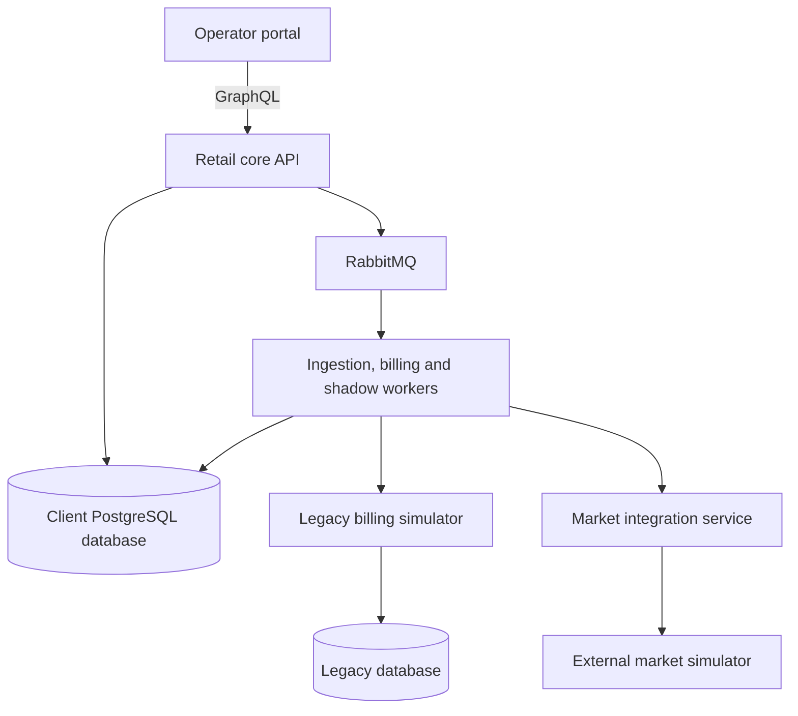

# Taryx

**Australian retail energy billing, financial ledger and safe migration platform.**

Taryx is a portfolio project exploring how an energy retailer can produce explainable bills, handle corrected meter data and safely replace a legacy billing system while continuing to serve customers. Its architecture follows publicly documented principles from Kraken Customer: a layered Django modular monolith, specialised asynchronous workers, client-specific configuration and carefully bounded external integrations.

Implemented features:

- Versioned NEM12 interval ingestion with revisions, conflict detection and quarantine
- Deterministic itemised rating against versioned tariffs, with GST
- Durable billing operations, immutable invoices and successive corrections
- Balanced double-entry journals with idempotency safeguards
- Shadow-engine comparison, scoped discrepancy decisions and cohort cutover
- Two isolated client retailers on one image — separate databases, policies and queues
- Bounded market transfer workflow with deterministic counterparty simulators
- Correlated structured logs, a `/metrics` endpoint and an optional Sentry path
- Enterprise-console operator portal (React/GraphQL) with light/dark/auto themes
- Kubernetes delivery on kind: migration Jobs, network policies, rollout gates
- Measured recovery, batch and ingest budgets with recorded fault scenarios

## Project idea

An energy bill connects several kinds of information: customer agreements, meter readings, tariff versions, historical commitments and financial records. Those inputs can change or arrive late. Replacing the software that interprets them requires more than reproducing a final invoice total.

Taryx brings these concerns together in an operator-facing application. A retailer's operations team should be able to understand how a bill was calculated, trace an adjustment back to corrected data, investigate differences between old and new billing engines, and make an informed migration decision.

The central capabilities are:

- **Explainable billing:** turn interval consumption and export data into itemised charges using versioned tariff agreements and explicit rounding policies.
- **Meter revisions and adjustments:** retain the history of incoming readings and produce traceable adjustments when corrected data affects an issued bill, preserving the original invoice.
- **Financial integrity:** record balanced double-entry ledger transactions, with transactional safeguards and idempotency to prevent duplicate financial effects during retries.
- **Safe legacy migration:** compare legacy and replacement calculations in shadow mode, investigate discrepancies and progressively switch customer cohorts to the new engine.
- **Client variation:** run fictional Australian retailers from the same application image with isolated databases, configuration and client policies.
- **Resilient market integration:** demonstrate a bounded asynchronous workflow against a simulated external counterparty, including delayed, duplicated and rejected messages.

Alongside NEMLab's wholesale market analysis, Voltix's equipment control and Cateniq's spatial engineering tools, Taryx adds retail operations and transactional business software to the portfolio. It also provides a focused setting for the domain modelling, fault tolerance and client-specific engineering described in Kraken's Client Engineering role.

## Background: Kraken's published architecture

Kraken Customer is the customer-management platform within the wider Kraken business. Its engineering publications describe a large Django monolith maintained in a shared repository. Kraken Flex uses a different, microservices-based architecture; some market integrations have also been separated from the Customer monolith where their deployment and compliance requirements warrant it. [Kraken architecture update, March 2026](https://engineering.kraken.tech/news/2026/03/09/how-we-ship-2026.html)

David Seddon's account of Kraken's code organisation describes three layers: `clients`, `territories` and `core`. Dependencies flow downward, while individual client packages and individual territory packages remain independent. Import Linter enforces these boundaries. The article also describes separate instances for utility clients, sharing common behaviour while supporting client and territory differences. [Kraken's Python monolith, July 2023](https://blog.europython.eu/kraken-technologies-how-we-organize-our-very-large-pythonmonolith/)

Kraken's deployment publications describe Kubernetes, independently scaled worker workloads, GitOps delivery through ArgoCD, and database migrations run as Jobs. A separate article documents RabbitMQ as a Celery broker. Its release practices include running old and new implementations in parallel to detect behavioural differences before switching over. [Kubernetes and delivery](https://engineering.kraken.tech/news/2026/02/11/django-kubernetes-health-checks-continuous-delivery.html), [RabbitMQ and Celery](https://engineering.kraken.tech/news/2026/01/09/upgrading-rabbit-mq-without-breaking-celery-eta-tasks.html), [Parallel experimentation](https://engineering.kraken.tech/news/2025/02/07/how-we-ship.html)

These sources establish the architectural inspiration for Taryx. They do not expose Kraken's complete production topology, Australian implementation or proprietary domain model. Taryx is an independent project applying those published principles at portfolio scale, with its own service boundaries and data-isolation choices.

## Architecture overview

The retail core is a **modular monolith**. Accounts, metering, pricing, billing, ledger and migration logic share a Django application and a transactional PostgreSQL database within each client instance. Meter ingestion remains inside this application, running on dedicated workers rather than becoming a separate data-owning service.



The diagram shows the main interactions for one client instance. The API and specialised workers use the same core application image, deployed as separate workloads with their own queues and resource allocations. A second retailer uses the same code with separate configuration and database credentials.

Inside the application, the dependency direction is:

```text
clients → territories → core
```

The core provides shared business capabilities. The Australian territory layer supplies market-specific behaviour, and client packages supply fictional retailer policies. Interfaces and application composition connect those policies to GraphQL and background processing without requiring the core to import client implementations. Import Linter makes these boundaries enforceable.

Three surrounding components provide distinct integration boundaries:

| Component | Purpose |
| --- | --- |
| Legacy billing simulator | Represents the system being replaced, including historical policies, known defects and its own database. |
| Market integration service | Owns protocol translation, workflow state, retries and response reconciliation for a bounded market interaction. |
| External market simulator | Represents a counterparty outside the retailer's control and generates reproducible delays, duplicates, rejections and failures. |

The operator portal exposes bills, adjustment history, migration evidence and operational exceptions. Observability supports diagnosis across the API, workers and integrations.

## Safe change as a product capability

Taryx uses the **Strangler Fig pattern** to replace legacy behaviour incrementally behind a routing boundary. Shadow calculations compare line items, quantities, tariff versions and rounding as well as totals. They must remain unable to issue customer invoices or post financial entries.

**Chesterton's Fence** informs how discrepancies are investigated: understand why historical behaviour exists before replacing it. Some differences reveal a customer commitment that the new system must preserve; others reveal a legacy defect that should be explicitly corrected. Both need recorded evidence and an auditable decision.

Historical commitments in the demo are clearly labelled fictional client policies. Australian formats and market behaviour require their own documented sources; invented scenarios are not presented as regulations. The market simulator is a bounded test double, not an implementation of the entire AEMO market. Retail billing is the product focus, rather than wholesale market clearing or a complete utility operating system.

## Technology direction

| Area | Technology and role |
| --- | --- |
| Retail application | Python and Django for the domain model, persistence and application services |
| API | GraphQL with Graphene for the operator portal |
| Financial and operational data | PostgreSQL with explicit transactions, constraints and versioned records |
| Background processing | Celery with RabbitMQ and specialised worker queues |
| Operator experience | React and TypeScript (Vite), enterprise-console design with light/dark/auto themes |
| Architecture enforcement | Import Linter for layer and package boundaries |
| Local environment | Docker Compose for repeatable development and integration scenarios |
| Deployment | Kubernetes on kind via [deploy/k8s](deploy/k8s/README.md), with separate API and worker Deployments and database migration Jobs |
| Observability | Structured JSON logs with correlation IDs and redaction, a Prometheus text-format `/metrics` endpoint, and an optional Sentry capture path (DSN-gated) |
| Verification | Automated domain and integration tests, legacy comparison scenarios and controlled failure injection |

The architectural objective is a system whose bills can be explained, whose changes can be audited and whose recovery behaviour can be demonstrated — and all three have measured evidence under `docs/project/evidence/`.

## Development setup

Requires Docker with Compose, `uv` and Node 22 on the host.

```text
make install    # uv sync (locked Python deps) + npm ci for the portal
make up         # build and start PostgreSQL, RabbitMQ, API, worker and portal
make check      # ruff lint/format, mypy, import contracts, pytest, web typecheck/build
make down       # stop the stack
make reset      # stop and drop the taryx-pgdata / taryx-broker volumes
```

Endpoints once running (Aurora Energy client): API `http://localhost:8001` (`/healthz`, `/graphql`, `/metrics`), portal `http://localhost:5174`, RabbitMQ management `http://localhost:15673`, PostgreSQL `localhost:55432`, AMQP `localhost:5673`. The second client (Southgrid Retail) serves API `http://localhost:8002` and portal `http://localhost:5175`. Host ports are offset from the defaults so sibling project stacks can coexist; container-internal ports are unchanged.

Host-side commands (`uv run pytest`, `uv run python manage.py ...`) target these published ports by default. Celery worker remote control (inspect/revoke broadcasts) is disabled: kombu's pidbox mailbox declares transient non-exclusive queues that RabbitMQ 4 rejects.

For the full two-client stack with seed data, demo logins, portal walkthrough and simulator fault injection, see [run-local.md](docs/run-local.md). For a clean Kubernetes install/reset on kind, see [deploy/k8s/README.md](deploy/k8s/README.md).

## Project documentation

- [Agent workflow](AGENTS.md) and [documentation guide](docs/project/documentation-guide.md)
- [Architecture](docs/project/architecture.md), [roadmap](docs/project/roadmap.md) and [backlog](docs/project/backlog.md)
- Feature contracts: [metering and rating](docs/project/features/metering-and-rating.md), [billing and ledger](docs/project/features/billing-and-ledger.md), [legacy migration](docs/project/features/legacy-migration.md), [operator and clients](docs/project/features/operator-and-clients.md), [market integration](docs/project/features/market-integration.md), [verification](docs/project/features/verification.md)
- [Open questions](docs/project/blockers.md) and work journals ([2026-10](docs/project/journal/2026-10.md), [2026-11](docs/project/journal/2026-11.md))

## Demos and evidence

- **Portal design demos** (open in a browser): [index](docs/design/index.html), [design A — mission console](docs/design/design-a-console.html), [design B — enterprise suite](docs/design/design-b-suite.html) (applied to `web/`), [login](docs/design/login.html)
- **Recorded operator journey**: [demo-journey.txt](docs/project/evidence/m5/demo-journey.txt) — clean setup through ingest, billing, correction, cohort cutover, client isolation and market transfer
- **Walkthrough**: [walkthrough.md](docs/project/evidence/m5/walkthrough.md), and the [verification audit](docs/project/evidence/m5/verification-audit.md)
- **Measured release**: [portfolio-run.md](docs/project/evidence/m5/portfolio-run.md) — 100-account × 30-day batch in 8.3 s, ingest repeats under 60 s, peak 5.76 GiB
- **Fault and deployment evidence**: [fault-campaign.md](docs/project/evidence/m5/fault-campaign.md) (seven real-process scenarios), [kubernetes.md](docs/project/evidence/m5/kubernetes.md), [diagnostics.md](docs/project/evidence/m5/diagnostics.md)

M1–M4 are complete and independently approved ([M1](docs/project/evidence/m1/m1-metering-independent-review.md), [M2](docs/project/evidence/m2/m2-independent-review.md), [M3](docs/project/evidence/m3/m3-independent-review.md), [M4](docs/project/evidence/m4/m4-review-r5.md)). M5 implementation is complete; its independent review is pending. See the [backlog](docs/project/backlog.md) and [roadmap](docs/project/roadmap.md).
