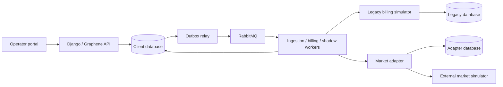

# Taryx architecture

Date: 2026-10-25
Status: Planning baseline. Concept choices are accepted through the user's agreement with the reviewed project direction. Detailed contracts below are design selections within the requested planning work, subject to the named verification gates. M1 implementation is verified against the original review findings. M2 findings from the [independent review](evidence/m2-independent-review.md) are remediated and re-verified. Unimplemented sections remain design intent.

See [overview and Kraken sources](../../README.md), [scope decision](decisions/002-scope-and-architecture.md), [roadmap](roadmap.md) and [backlog](backlog.md).

## Product and system boundary

Taryx serves a fictional Australian electricity retailer's operations team. It turns versioned interval readings and tariff agreements into explainable bills and ledger entries, then demonstrates replacement of a legacy calculator using preserved evidence. Two separately configured retailers exercise client variation. A bounded market interaction demonstrates resilient integration rather than wholesale settlement or regulatory certification.

The initial product supports AUD, one Australian territory, synthetic data and a small set of explicitly defined import/export tariffs. Payments, collections, concessions, real customer data, gas, VPP dispatch, wholesale clearing and full MSATS implementation are outside the baseline. A second jurisdiction is a future candidate, not required to prove the abstraction.

## Code boundaries

```text
src/taryx/
  core/
    accounts/       Customer, supply point, meter channel, tariff agreement
    metering/       Ingestion batches, readings, revisions, quality and provenance
    pricing/        Tariff versions, rating inputs and calculated line items
    billing/        Billing runs, invoices, adjustments and balanced journals
    migration/      Cohort routing, comparisons, discrepancy decisions
  territories/au_nem/   Australian profile and policy implementations
  clients/              Fictional retailer policy/configuration packages
  interfaces/           GraphQL and task entry points
  composition/          Select configured client and inject policies
services/
  legacy-sim/           Independent legacy calculator and database (separate image)
  market_adapter/       Durable external workflow and reconciliation
  market_simulator/     Controlled external counterparty
web/                    React/TypeScript operator portal
```

This is a proposed layout, not existing code. Imports follow `clients → territories → core`; clients do not import other clients and territories do not import other territories. Core cannot import interfaces, composition or service implementations. Composition may select and inject higher-layer implementations through core-defined protocols. Thin interface handlers call application services; domain calculations do not depend on GraphQL or Celery task objects.

Within core, accounts and metering expose explicit access functions; pricing consumes immutable input values; billing coordinates input snapshots, pricing and postings; migration coordinates legacy/new calculation and calls billing for authoritative issuance. Billing receives a selected calculation strategy rather than importing migration. Define and enforce the actual import graph during bootstrap, avoiding circular domain dependencies. Django ORM usage is allowed in persistence/application services; pure tariff arithmetic remains separately testable.

## Runtime and ownership



API, workers and relay use the same core image. Workers have independent queues and resource limits; metering is not a separate data-owning microservice. PostgreSQL is the source of business state; RabbitMQ transports work, not authoritative financial records. The adapter owns its own workflow store and accesses core through contracts, never direct core-table writes. One local PostgreSQL server may host separate databases/roles; that is logical isolation, not independent infrastructure availability.

Each client has separate database credentials, broker vhost/credentials and runtime configuration. No caller-supplied client selector can redirect a request into another client instance. The same image runs both clients. The legacy calculator has an independent schema; the external simulator is a test fixture outside Taryx's business trust boundary even when hosted in the same local cluster.

## Durable processing and transactions

A mutation validates its request and commits an operation record plus outbox message in one PostgreSQL transaction. An outbox relay publishes and marks delivery; a crash can cause duplicate delivery. Consumers deduplicate using stable business operation identities and payload hashes. An operation ID reused with a different request is rejected. Do not claim exactly-once transport.

Persist queued/running/succeeded/failed work state and attempt history. Running attempts use bounded leases; reconciliation identifies abandoned attempts and safely retries from recorded inputs. Task acknowledgements, retries, timeouts, poison-message handling and lease expiry must be configured and tested together. `transaction.on_commit` alone does not close the commit-to-publish crash window.

Money uses Decimal with a frozen rounding profile. Issuance is an atomic transaction: validate input/routing revisions and expected billing generation, acquire the appropriate lock, create an immutable invoice and balanced journal, and record completion. Unique business keys prevent concurrent operations with different request IDs from issuing the same bill generation twice. Journal balance is a cross-row invariant: implement and test the posting boundary and database enforcement strategy explicitly; a simple row CHECK is insufficient.

A calculation is pinned to meter revision selection, tariff/agreement versions, period, client policy version and engine identity. Changes arriving during calculation make it stale for issuance and schedule a new generation. Issued documents remain unchanged; subsequent corrections produce linked adjustment documents and ledger entries. Feature contracts define behaviour in [billing](features/billing-and-ledger.md) and [metering](features/metering-and-rating.md).

## Legacy migration boundary

Both calculators receive the same immutable input snapshot. The legacy service returns calculation evidence only; core remains the single invoice/ledger writer for this demonstration. This is a migration of calculation responsibility, not a claim to migrate an entire historical accounting database.

`LEGACY_ONLY`, `SHADOW` and `NEW_ONLY` select the authoritative calculator for new operations. Existing operations retain their recorded mode/version; cutover checks for in-flight issuance or explicitly drains it. Shadow work persists comparison evidence under restricted credentials and cannot invoke issuance or write financial tables. Comparison errors are inconclusive, never parity. Reverting future routing does not reverse issued bills. See [migration contract](features/legacy-migration.md).

## Interfaces and operator controls

GraphQL provides bounded/paginated account, reading, bill, operation and migration views. Mutations start ingestion/billing operations, resolve discrepancies and change cohort routing; long work returns an operation identity rather than holding a request open. Explicit error codes distinguish invalid inputs, conflict, permission denial and recoverable infrastructure failure.

Use authenticated seeded operators for the local demo and explicit viewer/operator/migration-approver permissions. Server-side checks and audit records protect issuance, discrepancy decisions and cutover. Choose and test the session/authentication mechanism during API design; no public production identity service is claimed. External HTTP contracts use schema versions, correlation IDs and idempotency keys; neither Celery task names nor ORM objects are public integration contracts.

## Deployment and operations

Docker Compose is the first reproducible environment. Kubernetes delivery uses kind, separate API/worker Deployments, a migration Job, health probes, graceful termination and isolated credentials. Keep old compatible workloads running while expand/contract migrations execute. Test recovery from forced termination separately from graceful shutdown. KEDA-based queue scaling is introduced only with a measured workload and explicit limits; production-scale capacity is not inferred from a laptop demo.

Prometheus/Grafana expose queue age, operation latency, failed/retried work, ingestion rejection, parity outcomes and adjustment counts. Use bounded labels, structured correlation-aware logs and OpenTelemetry tracing. Sentry integration is optional at runtime so local demonstrations need no external account; test SDK emission with a local capture if hosted verification is unavailable. Redact customer-like values and payloads from diagnostics.

AWS EKS, Terraform, ArgoCD and public hosting are future options. They are Kraken references, not required infrastructure for the initial local portfolio deliverable. Dependency versions and supporting-service frameworks are selected and pinned after compatibility checks in TAR-003; no version numbers are asserted here.

## Verification gates

[Open questions](blockers.md) identify the metering/tariff profile, market workflow and measurement budgets that still require evidence. [Verification contract](features/verification.md) owns the scenarios. Each milestone exit records the observed environment and outcomes; accepted design is not evidence of runtime correctness.
